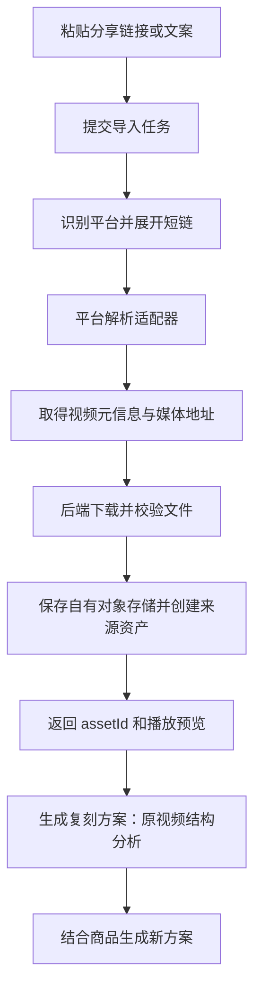

# FashMaker 爆款复刻 · 结构复刻开发说明

> 交付状态：可进入开发拆解与联调设计。版本：2026-11-04。  
> 对应原型：[viral-remix.html](../viral-remix.html)。字段枚举与默认值统一以 [developer-field-contract.md 第 6 节](developer-field-contract.md#6-爆款复刻--结构复刻) 为准。  
> 本文区分已确认交互、当前原型实现和正式服务接入要求。“可开发”不表示真实解析、AI 或视频生成服务已经上线。

## 1. 目标与范围

运营人员导入一个参考视频，选择或填写自己的商品，生成可编辑的结构复刻方案，确认后生成商品视频。复用参考视频的开场、节奏和叙事结构，围绕新商品重新组织内容。

本次包括：抖音 / 小红书 / 快手链接导入、本地视频上传、视频资产选择、手动商品信息与图片、商品库选择、AI 识别商品信息、结构方案编辑与调整、生成结果、完整历史及商品结果关联。

本次不包括：换人换物、热门爆款推荐、批量复刻、积分计费、发布视频、声音克隆。原型没有真实视频生成、结果文件下载和云同步；这些不能按已实现能力验收。

## 2. 入口与页面布局

| 入口 / 阶段 | 页面与交互 |
| --- | --- |
| 侧栏、顶部功能导航 | 「爆款复刻」进入独立页面，默认结构复刻 |
| 商品详情「用此商品创作 → 爆款复刻」 | 带入稳定商品 ID、当前名称、描述、卖点及商品图片，目标视频仍需选择 |
| 第一步：导入素材 | 左侧配置视频、商品、语言与区域；右侧展示功能说明和体验示例 |
| 第二步：结构方案 | 隐藏第一步配置栏，展开原视频与策划双栏；支持查看分析、逐镜头修改、调整及上一步 |
| 第三步：视频结果 | 左侧恢复第一步参数栏，保留本次全部输入并只读显示；右侧显示本次结果与生成参数 |
| 历史记录 | 顶部按钮打开历史浮层；关闭后回到当前任务，不把历史铺在右侧工作区 |

结果页的左侧包括视频来源、商品图、名称、描述、卖点、语言和投放区域。隐藏底部「生成复刻方案」按钮；上传、移除、AI 识别等修改操作不可用。模型、比例和清晰度显示在右侧结果参数中。结果页不提供返回分镜编辑入口，使用「新建复刻任务」开始下一次。

窄屏采用上下布局，结果页仍保留第一步参数栏；长内容可滚动查看。

## 3. 目标视频导入

### 3.1 通用规则

- 每个任务只使用一个当前目标视频；链接、本地和资产库三种来源互斥，成功导入的新来源替换旧来源。
- 新来源失败时保留原可用视频。修改当前链接来源的分享文案后，该来源失效，必须重新拉取；输入待解析链接不立即移除已有本地或资产视频。
- 视频卡片展示来源、标题或文件名、时长及画幅信息，支持移除；移除只清空本任务引用，不删除资产库视频。
- 原视频可播放时展示播放器；只有演示封面时明确标注演示，不展示可播放成片的承诺。
- 异步返回必须校验当前任务及输入版本；切换来源、移除、新建后，旧请求不得覆盖新来源。

### 3.2 平台链接

粘贴详情链接或含链接的分享文案，点击「拉取视频」。提取首个 HTTP / HTTPS URL，并按域名匹配；允许以下主域及子域，不允许通过字符串包含伪造域名。

| 平台 | 支持的域名 |
| --- | --- |
| 抖音 | douyin.com、iesdouyin.com |
| 小红书 | xiaohongshu.com、xhslink.com |
| 快手 | kuaishou.com、gifshow.com |

拉取中按钮禁用并显示「拉取中…」。没有链接或不支持的平台提示「请输入抖音、小红书或快手的有效分享链接」。正式服务需解析短链并返回视频元信息及可用视频引用；网络错误、失效或不可访问视频应保留输入并允许重试。

**当前原型**仅校验域名，载入统一 15 秒、9:16 示例，不实际访问平台视频。

### 3.2.1 链接拉取的开发方案（待接入）

正式版「拉取视频」应获取真实视频文件并入库，不能仅保存分享链接或临时播放地址。该能力在第一步完成；只有文件校验及资产入库成功，才把本次链接来源设为可用于分析的目标视频。

#### 开源选型候选

以下为仓库声明与文档核查结果，未进行真实分享链接成功率测试，不视为最终选型或稳定性承诺。

| 候选 | 已声明范围 | 在本方案中的定位 |
| --- | --- | --- |
| [yt-dlp](https://github.com/yt-dlp/yt-dlp) | [官方支持列表](https://github.com/yt-dlp/yt-dlp/blob/master/supportedsites.md)包含 Douyin、XiaoHongShu；项目明确提示列出不保证当前可用 | 抖音、小红书首轮验证候选；通过后封装成独立 worker，不假设覆盖快手 |
| [Douyin_TikTok_Download_API](https://github.com/Evil0ctal/Douyin_TikTok_Download_API) | 自托管抖音、TikTok、B 站解析下载 API，提供 Docker 部署 | 抖音专用候选，与 yt-dlp 对比实际成功率；不能作为小红书、快手统一后端 |
| [multiplatform-downloader](https://github.com/Janusilver/multiplatform-downloader) | 项目声明支持抖音、小红书、快手分享链接；[说明](https://github.com/Janusilver/multiplatform-downloader/blob/main/README.en.md)列出各平台 Cookie 要求 | 参考各平台独立解析实现，尤其快手；下载工具仍需封装服务接口，采用前核对许可证与依赖 |

建议建立统一导入服务，下挂抖音、小红书、快手三个适配器。先用实际样本验证，再确定每个平台的主实现；不把某个开源项目直接绑定到前端，不让前端承担平台 Cookie、签名或文件下载逻辑。

#### 服务处理规则

1. 前端提交当前 taskId、原分享文案、提取 URL、输入版本及幂等键；后端再次校验 URL，不信任前端平台识别结果。
2. 短链展开后获取规范页面 URL、平台视频 ID。校验每次跳转及最终媒体请求目标，拒绝内网地址、非 HTTP / HTTPS 协议和未经校验的跳转；媒体 CDN 与分享站点分别维护允许规则。
3. 适配器返回平台、视频 ID、标题、封面及可用媒体信息；登录态等凭据只在服务端管理，不出现在前端响应、历史快照和日志正文中。
4. 后端下载到临时文件，设置超时、重定向次数及大小限制，流式下载时也执行大小检查，不只检查 Content-Length。链接下载的具体服务限额由后端配置，不能沿用未确认的时长上限；本地上传仍按已确认 100 MB 限制。
5. 检查真实媒体类型、文件可解码性、时长与尺寸，必要时生成可播放预览；使用 ffprobe / FFmpeg 等媒体工具完成探测与处理。图文笔记或图集不能冒充视频成功导入。
6. 视频及封面保存到自有对象存储，创建来源 assetId，归类「上传素材」，来源标记为平台链接导入。原视频不得归入「AI生成」，也不因本次关联商品而自动成为该商品的 AI 结果。
7. 返回成功资产后展示可播放的原视频，后续结构分析、方案和历史统一引用 assetId。不要把会过期的平台播放地址作为最终资产引用；前端播放地址可按权限重新签发。
8. 成功结果须匹配当前 taskId 和输入版本后才应用。用户切换来源、新建或移除时，取消或忽略旧导入结果；已创建但未使用的资产按资源清理策略处理，不能覆盖当前视频。

#### 接口职责与字段建议

以下是建议契约，接口路径、轮询或推送方式由工程联调确定，不表示当前 HTML 已有这些接口。

| 操作 | 请求 / 返回内容 |
| --- | --- |
| 创建链接导入任务 | 请求：taskId、shareText、sourceUrl、inputVersion、idempotencyKey；返回：importId、status |
| 查询导入进度 | importId、taskId、inputVersion、status、stage、errorCode、message、retryable；完成前不返回可分析的成功资产 |
| 导入成功 | assetId、platform、platformVideoId、canonicalUrl、title、mimeType、sizeBytes、durationMs、width、height、previewUrl、posterUrl |
| 取消或丢弃旧任务 | importId 与输入版本；即使下载无法立即中止，也阻止旧结果应用到当前任务 |
| 开始视频分析 | 使用成功 assetId 和文件版本；分析产物与商品适配方案分别保存 |

建议导入状态为 queued → resolving → downloading → validating → storing → succeeded；任一处理阶段可转 failed，取消转 canceled。UI 可统一显示「拉取中…」，同时展示解析、下载、入库的阶段文案，不展示虚假的百分比。

这里的输入版本与文件版本用途不同：前者防止旧异步响应覆盖新输入，后者用于识别原视频是否改变。同一视频文件及相同分析配置可复用已完成分析；仅修改商品信息时只重新生成商品适配方案，不必重复下载或分析视频。

#### 错误与兜底

| 错误场景 | 产品处理 |
| --- | --- |
| 链接不支持、解析到图文而非视频 | 明确提示不支持当前内容，提供本地上传和资产库入口 |
| 视频删除、私密或不可访问 | 保留用户输入，提示无法获取，不伪装成成功 |
| 需要登录态或访问受限 | 返回可理解错误，提供本地上传；不要求用户在普通表单粘贴账号 Cookie |
| 平台解析规则变化 | 标记该适配器异常，避免无限重试；维护修复与告警 |
| 网络超时、临时下载失败 | 有界重试，次数和退避由后端配置；用户可手动重试 |
| 文件超限、不可解码 | 不创建可用来源资产，清理临时文件，提示更换文件或本地上传 |
| 已下载但入库失败 | 仍为导入失败；保留可恢复的服务状态，重试入库不重复创建资产 |

成功、失败和超时均记录平台、适配器版本、阶段、耗时及错误分类，便于监控平台变更。项目采用前核对许可证与依赖，处理用户有权使用的视频；开源下载能力不等于平台官方授权或稳定下载保障。

#### 上线前验证与交付

分别准备三个平台的真实分享短链、详情链接及带文案链接；覆盖可访问视频、失效视频、非视频内容、需要登录态、过期媒体地址、下载中切换任务等情况。记录每个样本的解析、下载、入库成功情况及失败原因，再确定适配器选型。只有成功取得可解码文件、保存资产且可播放预览，才算「拉取视频成功」。

当前原型仍只模拟链接拉取。本节新增的是正式开发方案，未安装开源项目、部署后端或启用真实下载。

### 3.3 本地上传

| 项目 | 规则 |
| --- | --- |
| 数量 | 单选 1 个 |
| 格式 | MP4 / MOV / WEBM |
| 大小 | 不超过 100 MB，即 100 × 1024 × 1024 字节 |
| 元信息 | 时长必须有效且大于 0，必须能读取视频尺寸 |
| 失败 | 不支持的类型、超限、损坏、浏览器无法读取编码、读取超时或保存失败均提示；不把失败文件设为当前来源 |
| 导入成功 | 展示原视频播放器，并保存到本机资产库「上传素材」供再次使用 |

MOV 是允许选择的容器格式，不代表浏览器支持所有内部编码。原型提示不支持的文件换用 H.264 MP4 或 WEBM；正式服务可在后端校验与转码，不以文件扩展名替代内容校验。

### 3.4 从资产库选择

弹窗只列出视频相关记录，单选后立即带入并关闭。列表包含已上传的视频和 AI 视频演示项，展示名称、来源类型与可用时长。空态提示「资产库暂无视频，请先从本地上传」。读取失败提示本地存储异常。

已上传视频保留资产 ID 与真实视频引用；AI 演示项保留资产 ID 与封面并标记无可播放文件。删除资产不应破坏已经完成的历史快照。

## 4. 商品信息与 AI 识别

### 4.1 手动填写

上传至少一张商品图并填写商品名称；描述和卖点选填。支持逐张移除图片，卖点可逐条新增、编辑和删除。

点击「手动上传」从商品库商品切换为手动任务时，清空原商品 ID、商品图片和文本，再打开文件选择。纯手动任务没有 productId，结果只进入资产库「AI生成」。

### 4.2 商品库选择

单选商品后替换当前商品信息，带入名称、描述、卖点及最多 6 张图片。空态提供进入资产库添加商品的入口。商品库初始化时持久化演示商品稳定 ID，避免首次使用目录为空。

名称、描述、卖点可在本任务编辑，追加图片不解除商品关联。修改名称不能改变 productId；本页编辑不自动回写商品库原记录。视频来源资产的商品归属也不能替代本次选择的商品 ID。

### 4.3 AI 识别商品信息

| 状态 / 动作 | 规则 |
| --- | --- |
| 显示条件 | 手动填写商品时显示；选择商品库商品后隐藏 |
| 无商品图 | 按钮禁用；不要求先填写商品名称 |
| 点击识别 | 使用本次商品图片请求填写标题、描述及结构化卖点 |
| 识别中 | 显示「正在识别…」并禁止重复点击 |
| 成功写入 | 标题为空则填写；已有标题保留；描述和卖点替换为本次结果 |
| 后续编辑 | 三个字段均可继续编辑，也可再次识别 |
| 输入变化 | 等待期间若任务、图片、商品关联或任意商品文本变化，丢弃旧结果并提示重新识别 |
| 失败 | 保留原有商品信息，提示重试 |
| 历史 | 保存最终编辑后的标题、描述和卖点，不重新读取商品库覆盖历史 |

**当前原型**使用通用演示文案，不具备视觉识别能力。正式服务根据图片返回可确认的信息；无法确认的规格、材质和功效不能凭空填写。

## 5. 字段与默认值

下表摘录当前开发字段契约，不增加独立枚举口径。

| 字段 | 必填 / 限制 / 选项 | 默认 |
| --- | --- | --- |
| 目标视频 | 三种来源任选一个，成功导入后可继续 | 空 |
| 商品图片 | JPG / JPEG / PNG / WEBP；1–6 张，每张最多 10 MB | 空 |
| 商品名称 | 必填，校验去除首尾空白，最多 100 字符 | 空 |
| 商品描述 | 选填，最多 2000 字符 | 空 |
| 卖点 | 选填，多条，每条最多 200 字符；无额外条数上限 | 空 |
| 语言 | 简体中文、英语、日语、西班牙语 | 简体中文 |
| 投放区域 | 中国大陆、美国、日本、英国、东南亚 | 中国大陆 |
| 视频模型 | Seedance 2、Seedance 2 Mini | Seedance 2 |
| 清晰度 | 720P、480P、1080P | 720P |
| 画面比例 | 9:16、1:1、16:9 | 9:16 |
| 策划时长 | 原型固定 15 秒，不提供时长选择 | 15 秒 |
| 镜头 | 原型三个镜头，内容不可为空 | 0–4、4–10、10–15 秒 |
| 调整要求 | 自由文本，可多次提交 | 空 |

当前图片以最长边 1200px 的 JPEG 保存到原型本地快照，不能将该预览处理规则误作正式原始素材存储方案。

## 6. 结构方案与视频生成

### 6.1 生成方案

满足「已导入目标视频 + 商品名称非空 + 至少一张商品图」后，「生成复刻方案」可用。点击后展示原视频和视频策划。

「查看分析」显示原视频的结构拆解：开场钩子、卖点展开、记忆收尾。策划包含商品参考图、分镜时间段和逐镜头内容，用户直接在镜头文本中编辑。

原型固定输出三个示例镜头，原视频实际时长仅用于来源展示，不会改变 15 秒示例策划。正式服务接入时应返回真实分析时间轴与可生成的策划时间轴，不能把示例时间段当作已完成的真实识别能力；模型支持的真实时长和参数组合须由服务端能力配置校验，当前未确认额外限制。

### 6.2 调整与返回

- 调整要求为空时提示先输入，不修改方案。
- 提交调整后更新当前方案，保留调整记录；用户可再次编辑镜头。
- 原型将要求追加到每个镜头文本，未实际执行 AI 改写。
- 「上一步」回到配置并保留输入；再次生成方案会重建镜头，清空此前调整记录及调整输入框。

### 6.3 生成视频

在方案页选择模型、清晰度与画面比例，点击「下一步 · 生成视频」。任一镜头内容为空时阻止提交，提示补全。提交使用用户最后编辑的镜头内容和当前参数。

生成期间锁定本任务操作，禁止重复提交、切换输入或新建。成功进入结果页，左侧恢复只读参数栏，右侧直接显示本次结果；不自动返回方案页。

正式生成失败应保留方案与参数，展示错误原因并允许重试，不创建成功结果资产。原型使用计时器模拟成功，没有真实任务队列与生成失败重试服务。

## 7. 状态与按钮约束

| 状态 | 用户可做什么 | 离开条件 |
| --- | --- | --- |
| 配置未完成 | 导入视频、填写商品、AI 识别；生成方案禁用 | 必填项齐全 |
| 配置可提交 | 继续编辑或生成方案 | 点击生成方案 |
| 拉取 / 上传读取中 | 当前来源入口显示忙碌状态，旧异步结果不可覆盖新任务 | 成功更新来源，失败保留输入 |
| 商品识别中 | 识别按钮禁用；用户编辑时旧结果作废 | 成功填入或失败提示 |
| 策划可编辑 | 编辑镜头、调整、上一步、选择视频参数 | 提交生成 |
| 视频生成中 | 本任务操作锁定 | 成功展示结果，正式失败回策划 |
| 结果 | 查看左侧只读参数与右侧结果、打开历史、新建任务 | 新建或历史重用 |
| 历史详情 | 查看完整输入、参数、分镜、结果；复制为新任务 | 关闭或再次生成 |

## 8. 历史、资产与数据契约

### 8.1 任务快照

每次生成使用独立 taskId。已完成任务保存以下数据；正式服务存储素材引用及必要元信息，原型将本地数据保存在快照中。

| 对象 | 需要保存的数据 |
| --- | --- |
| 任务 | taskId、创建时间、任务阶段、来源功能 |
| 原视频 | sourceType：link / upload / asset；原始分享文案、规范 URL、平台、标题、来源 assetId、格式、大小、可用视频与封面引用、时长及宽高信息 |
| 商品 | 可空 productId、生成时名称 productName、描述、全部卖点、全部商品图 |
| 设置 | language、market、model、resolution、ratio、策划总时长 |
| 策划 | 全部镜头的起止时间与最终内容、调整记录、调整输入框内容 |
| 结果 | 结果 assetId、视频引用、封面、是否为演示项 |

旧链接快照可能无 sourceType，按链接来源兼容。原型 source.ratio 对上传视频保存像素尺寸字符串（如 180:320），不是生成参数 ratio 枚举；正式数据建议独立 width / height，避免混用。

### 8.2 归档与商品关联

1. 生成成功创建一个视频结果资产，source 为「爆款复刻」，assetType 为 video，携带 taskId。
2. 当前任务有 productId 时，结果同时出现在资产库「AI生成」和该商品详情；无 productId 时只进入 AI生成。
3. 商品关联必须使用稳定 ID，不靠同名、图片相似度或原视频所属商品推断。
4. 资产创建后写入商品关联及任务结果引用，正式服务保证一致性及重复回调幂等，不能重复创建成功资产。
5. 生成失败或取消不创建成功结果。归档失败与视频生成失败分开提示；不能因历史写入失败引导重复扣费生成。
6. 商品详情移除结果只解除关联；AI生成删除结果同步移除商品结果引用。商品被删除后保留历史及生成资产，当前商品关联置空。

### 8.3 新建与历史重用

「新建任务 / 新建复刻任务」清空当前视频来源、商品关联、图片、所有商品文本、分镜、调整和结果，并恢复字段默认值，产生新 taskId；保留旧历史。

历史按创建时间倒序，详情展示完整输入、商品图、视频来源与可用播放器、生成参数、分镜和结果。点击「以此任务再次生成」复制快照为新的 taskId，清除结果和完成时间，回到第一步；不覆盖或修改旧历史。再次提交方案遵循重新分析规则。

### 8.4 原型存储

| 内容 | 当前实现 |
| --- | --- |
| 完成任务历史 | IndexedDB：fashmaker-remix / tasks；数据库无法打开时回退 localStorage：fashmaker-remix-history |
| 已上传参考视频 | IndexedDB：fashmaker-reference-videos / videos |
| 生成演示资产 | localStorage：fashmaker-prototype-generated-assets |
| 商品目录 | localStorage：fashmaker-prototype-products |
| 未提交编辑 | 页面内状态，刷新不保证恢复 |

IndexedDB 写入失败并不自动重试 localStorage，原型会提示归档失败。浏览器存储不具备跨设备同步或线上数据持久化保证。已完成历史包含原视频快照，删除上传资产不删除历史中的输入。

## 9. 正式服务接入分工

以下描述服务职责和输入输出，不代表接口 URL、供应商或模型能力已定。

| 能力 | 输入 | 输出与接入要求 |
| --- | --- | --- |
| 视频解析、下载与来源资产入库 | 平台 URL、当前任务与请求版本、幂等键 | 按 3.2.1 的独立适配器流程解析短链、下载校验、存入自有对象存储，返回来源 assetId 与可播放预览；失败原因、输入版本校验及幂等 |
| 文件上传与资产读取 | 视频 / 图片文件或 assetId | 可持久化资产 ID、预览 / 播放引用、格式大小与尺寸；校验文件内容及用户权限 |
| 商品图片识别 | 本次商品图片引用 | 标题、描述、卖点数组；保留已有标题的前端应用规则；请求版本校验 |
| 视频分析与方案 | 原视频、商品快照、语言、区域 | 原视频分析、策划时间轴、逐镜头文本；区分分析原文与新方案 |
| 方案调整 | 当前镜头、调整要求、方案版本 | 更新后的镜头，保留编辑与调整记录 |
| 视频生成 | 确认后的镜头、商品图片、模型、清晰度、比例、任务 ID | 异步状态与失败原因；成功视频文件及封面；参数能力校验 |
| 历史及归档 | 完整输入快照、成功结果及 productId | 任务历史、结果资产、商品关联，保证一致性与幂等 |

## 10. 验收清单

| 编号 | 场景 | 预期 |
| --- | --- | --- |
| V01 | 粘贴三平台支持链接或分享文案 | 可导入当前视频；不支持域名及伪装子串被拦截 |
| V02 | 拉取中修改链接、新建或切换来源 | 旧响应不覆盖新输入 |
| V03 | 本地选择合法视频 | 显示文件元信息与播放器，可在资产库再次选择 |
| V04 | 视频超限、损坏、编码不可读 | 提示失败，不误设为有效来源 |
| V05 | 从资产库选择真实视频 / 演示项 | 单选替换；真实可播放，演示明确只有封面 |
| V06 | 链接解析完成但下载或入库未完成 | 不标记拉取成功，不能作为分析输入 |
| V07 | 下载完成并成功入库 | 原视频进入上传素材，返回来源 assetId，预览与后续分析使用该资产 |
| V08 | 超时、平台失效、受限或入库失败 | 分类提示与有限重试，可切换本地上传，不使用临时播放地址冒充资产 |
| V09 | 同一任务重复提交或旧版本返回 | 幂等处理，不重复建资产，不覆盖当前来源 |
| P01 | 缺视频、缺名称或缺图片 | 不能生成方案 |
| P02 | 上传商品图超 6 张或单图超限 | 按限制处理并提示；可逐张移除 |
| P03 | 从商品库带入并改名、追加图 | productId 不变；不自动修改商品库原记录 |
| P04 | 从商品库切换手动上传 | 清空旧商品关联与字段，结果只进入 AI生成 |
| P05 | 手动无图 / 有图 / 商品库选择 | 识别按钮分别禁用 / 可用 / 隐藏 |
| P06 | 识别成功后编辑或重复识别 | 三字段可编辑；保留已有标题，替换描述与卖点 |
| P07 | 识别等待中修改输入或新建 | 丢弃过期结果；失败不清空已有字段 |
| S01 | 生成方案、编辑镜头并调整 | 显示原视频与分镜；最后编辑内容用于生成 |
| S02 | 上一步后重新生成方案 | 输入保留，镜头重建，旧调整清空 |
| S03 | 空镜头提交 / 重复点击生成 | 前者阻止，后者只提交一次 |
| R01 | 生成完成 | 左侧参数只读、右侧本次结果，隐藏生成方案按钮 |
| R02 | 从结果新建 | 参数恢复默认且可编辑，旧历史保留 |
| H01 | 查看历史 | 完整输入、素材、镜头、参数和结果可追溯 |
| H02 | 从历史再次生成 | 产生新 taskId，复制输入，不覆盖旧任务 |
| A01 | 有商品 ID / 无商品 ID 生成 | 分别进入 AI生成及商品详情 / 仅 AI生成 |
| A02 | 失败、删除或重复归档 | 不误建成功资产，关联清理正确，幂等不重复 |
| D01 | 原型演示能力 | 页面与说明不把模拟解析、文案或结果封面描述为真实 AI 服务 |

## 11. 与原参考图及旧说明的差异

- 目标平台从参考图 TikTok 改为用户指定的抖音、小红书、快手，并增加本地和资产库视频入口。
- 默认语言和区域为简体中文、中国大陆；没有换人换物和积分计费。
- 商品手动填写增加「AI 识别商品信息」，当前为演示填入，后续接真实视觉服务。
- 结果页恢复第一步参数栏并只读显示；方案阶段仍展开原视频与分镜。
- 原型固定三个镜头、15 秒；输入视频真实时长不会改变示例策划。
- 旧说明“视频不能播放”仅适用于生成结果及 AI 演示封面，本地上传的原视频可播放。
- 旧说明“IndexedDB 失败时回退”精确为数据库无法打开时回退；实际写入失败提示异常，不保证自动回退成功。

## 自定义模型与导航修订（2026-11-10）

移除顶部横向功能快捷导航，保留左侧功能导航。通过左侧「自定义模型」管理配置；窄屏顶部提供同名入口。图片功能只列出图片模型，视频功能只列出视频模型；平台原有选项保留，保存后即加入对应下拉，切换本次模型不要求逐步选择。文字分析、文案、提示词和脚本固定使用 FashMaker 平台模型，不提供文字模型配置。详细字段、演示边界及验收见 [自定义模型配置](custom-models-flow.md)。

### 2026-11-10 布局统一修订

所有页面侧边栏采用 shared-sidebar.js / shared-sidebar.css 的同一结构与样式：216px 宽、FashMaker 品牌与副标题、首页、创作工具、管理、账号区；菜单顺序为视频创作、详情长图、商品套图、商品生视频、爆款复刻、AI 换装、穿搭分离、数字人口播、图文笔记、资产库。仅当前功能高亮变化。批量页也使用同一侧栏。模型管理保留在管理区域；设置按钮打开模型配置，创作记录打开当前功能历史。首页和视频创作暂分别链接现有详情页和商品视频页，不新增独立功能。

模型选择统一放在创作设置末尾、生成提示及按钮前；AI 换装清晰度在模型之前。商品生视频与爆款复刻模型从右侧策划区迁到左侧设置末尾。批量全局和单任务覆盖的模型均为最后参数；图文笔记放在输入框之后、发送操作之前。移动 DOM 保留原 select ID、事件与选择值，文字模型口径和生成规则不变。窄屏仍隐藏主侧栏，保留顶部模型管理入口。
