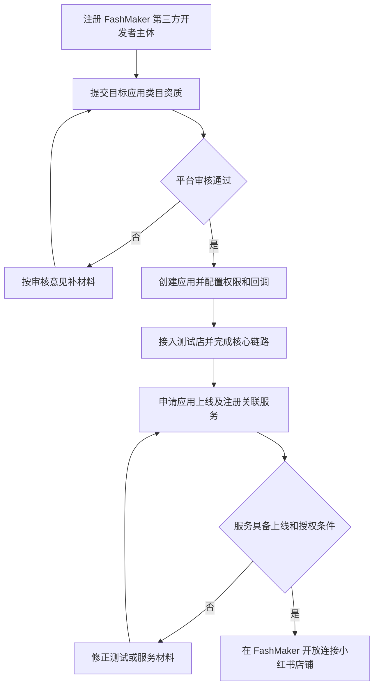
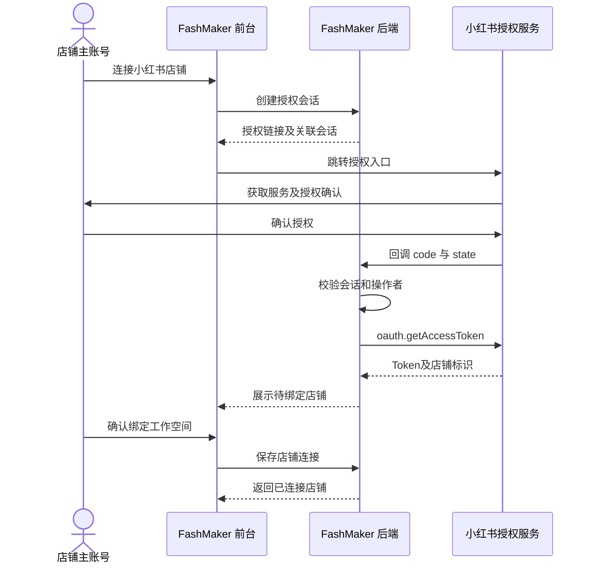
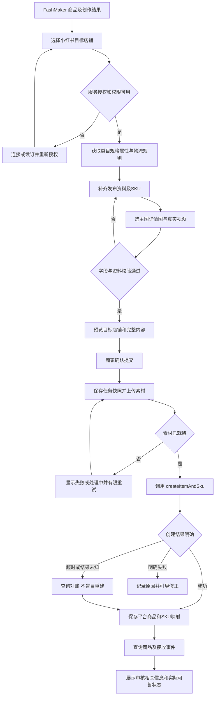
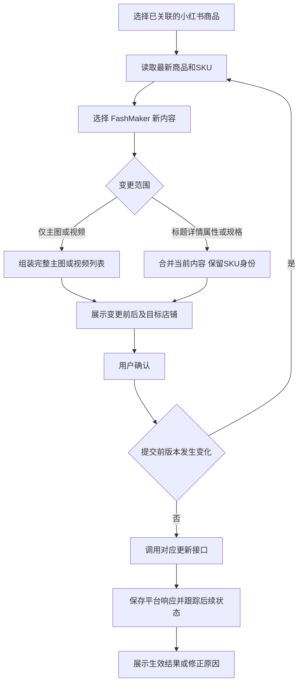
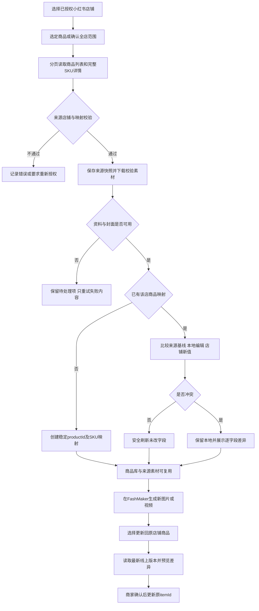

# FashMaker 接入小红书店铺商品发布：流程、字段与开发规格

版本：v1.1｜核查日期：2026-11-11｜平台：小红书电商店铺｜接入方：面向多商家的 FashMaker。

交付性质：正式服务的设计与开发建议，未实现真实授权、上传和发布。文中「官方已核实」指公开文档能力，不代表 FashMaker 已获权限；「产品约定」为建议的 FashMaker 行为；「联调确认」为尚不能从公开资料确定的项目。

## 1. 目标与首期范围

实现三条用户路径：

1. **授权店铺商品导入**：从已授权小红书店铺选择商品或全店导入，保留来源、商品和SKU映射，在 FashMaker 内创作后更新回原商品。
2. **新品上架**：在 FashMaker 选择商品及创作成果，补齐销售资料，发布到已授权小红书店铺。
3. **已有商品内容更新**：关联店铺商品，使用 FashMaker 的新主图、详情图或商品视频更新内容，保留原有商品与 SKU 身份。

首期限定：普通实物、现货，支持选品/全店读取导入；单次发布至一个店铺；工作空间可连接多店，历史按店铺区分。多店批量发布、跨境税、虚拟商品、预售、多仓、组合商品及完整库存同步后续独立开发。

商品发布不包含小红书图文笔记/视频笔记发布、笔记挂商品或直播操作；本套电商接口不能作为这些能力的证明。

当前商品库已有稳定 `productId`、标题、描述、卖点及关联图片/视频；缺少真实店铺连接、完整 SKU、售卖配置、平台字段规则和发布任务服务。现有本地存储仅作原型演示。

## 2. FashMaker 先申请什么

### 2.1 应用、服务和产品分别是什么

| 对象 | 含义 | 与 FashMaker 的关系 |
| --- | --- | --- |
| 开发者主体 | 平台审核的第三方开发者企业 | 由 FashMaker 运营主体申请 |
| 开放平台应用 | 接口身份、密钥、权限、回调配置 | 对接小红书的后台身份，不是必须新做一个 App |
| 服务市场服务 | 商家获取/订购的服务与套餐 | 关联应用及 FashMaker 的使用地址 |
| FashMaker 网站 | 用户管理商品、创作及发布的界面 | 可继续使用现有网站 |
| 店铺授权 | 特定店铺对应用的访问许可 | 每店独立，不因同一老板自动扩展到其他店 |

官方应用类目与接口权限、服务发布要求分别见 [应用开发（1）](https://open.xiaohongshu.com/document/developer/file/33)、[服务上架（3）](https://open.xiaohongshu.com/document/developer/file/43)。

### 2.2 类目选择建议

| 应用类目 | 官方权限说明中的范围 | 对 FashMaker 的判断 |
| --- | --- | --- |
| 商品优化 | 公共、授权、商品、库存、素材中心及商品消息 | 优先咨询，贴合制图后更新商品与完整度检查 |
| 一键搬家 | 公共、授权、商品、库存、素材中心及商品消息 | 侧重跨平台商品导入和铺货时咨询 |
| 图片工具 | 当前权限表仅授权、公共接口 | 不能据此假定拥有发品和店铺图片写入权限 |
| 商家自研 | 面向自身商家系统 | 不作为多商家 SaaS 的替代申请路径 |

以上是业务匹配建议，最终类目与权限由平台审核决定；不能为了获取接口而虚报功能。同一产品前端可容纳不同应用，但后台需按业务及应用隔离凭证。[应用类目及权限（1）](https://open.xiaohongshu.com/document/developer/file/33)

### 2.3 服务商准备清单

| 阶段 | FashMaker 需提供/完成 | 通过标准 |
| --- | --- | --- |
| 主体注册 | 企业与联系人、资质材料 | 平台审核通过 |
| 类目准入 | 产品说明、使用场景、可用演示、平台要求的团队/案例证明 | 获准创建目标类目的应用 |
| 应用配置 | 应用名称、说明、回调 URL、权限、服务域名等后台实际字段 | 获取应用标识及密钥，明确可用接口 |
| 开发测试 | 测试店授权、签名、规则读取、素材和发品链路 | 使用平台测试环境/店完成核心流程 |
| 上线及注册服务 | 服务名称、介绍、套餐、帮助说明、客服与跳转地址，按实际要求处理保证金 | 应用上线、服务具备可用授权入口 |
| 运营维护 | 套餐、有效期、授权状态、客服和接口变化维护 | 不只完成首次上线，还能持续服务 |

服务商资质、准入门槛和保证金要求受类目及规则影响，不在此固化历史金额、人员数或用户数；以申请后台及审核确认执行。[角色说明（27）](https://open.xiaohongshu.com/document/developer/file/103)、[商品管理规则（28）](https://open.xiaohongshu.com/document/developer/file/107)、[服务审核标准（29）](https://open.xiaohongshu.com/document/developer/file/102)

### 2.4 服务商接入流程图

流程来源：[应用开发（1）](https://open.xiaohongshu.com/document/developer/file/33)、[应用测试（6）](https://open.xiaohongshu.com/document/developer/file/34)、[服务注册与上架（3）](https://open.xiaohongshu.com/document/developer/file/43)。具体后台步骤顺序按实际平台审核流程执行。

## 3. 商家如何连接，多店如何处理

### 3.1 商家流程

1. 在 FashMaker「店铺管理」点击「连接小红书店铺」。
2. 后端检查对应应用与服务可用，创建一次有时效的授权会话。
3. 按服务展示范围，引导商家获取/订购服务并进入授权页。公开服务可从服务市场进入，官方也提供授权链接方案。
4. 由店铺主账号登录并确认授权；平台回调 `code` 及 `state`。
5. 后端验证 `state`，用 `oauth.getAccessToken` 换取令牌和 `sellerId`、`sellerName`。
6. 商家核对店铺身份，绑定当前 FashMaker 工作空间，返回商品库。
7. 后续用 `oauth.refreshToken` 维护令牌，授权失效时要求重新连接。

官方要求包括应用上线及注册服务、完成测试授权、主账号授权等。[新版三方授权（2）](https://open.xiaohongshu.com/document/developer/file/342)

产品约定：`state` 必须使用不可伪造的短期随机会话，绑定工作空间、登录用户、应用和返回地址；不能直接相信回调中的店铺名称，也不能允许任意跳转 URL。

### 3.2 多店铺规则（FashMaker 产品约定）

- 一个 FashMaker 应用可服务获授权的多家店铺，实际店铺额度受平台批准范围限制，不承诺无限量。
- 每个店铺独立授权、独立保存 Token、服务状态和权限；商家连接多店时逐店完成。
- 首期同一外部 `sellerId` 只允许绑定一个工作空间；跨空间转移需管理员处理，不静默抢占。
- 同一商品发布到多个店铺应生成独立发布配置、任务和外部商品映射。
- 店铺 A 的运费模板、物流方案、素材映射和商品 ID 不直接用于店铺 B。
- 服务有效、授权有效、接口权限可用是三项检查，不能用一个“已连接”替代。

### 3.3 授权时序图

获取服务及授权入口随展示/订购方案变化，不能把时序图理解成绕过服务获取条件。来源：[新版三方授权（2）](https://open.xiaohongshu.com/document/developer/file/342)。

## 4. 官方文档和核心接口

所有业务请求由 FashMaker 后端发送。新版电商文档使用统一网关 `https://ark.xiaohongshu.com/ark/open_api/v3/common_controller`；公共参数在 POST JSON 中携带 `appId`、`timestamp`、`version`、`method`、`sign` 及业务所需 `accessToken`。不得将详情中的展示路径直接拼成调用 URL。[系统参数（4）](https://open.xiaohongshu.com/document/developer/file/40)

签名与 Token 管理由平台适配器集中处理，AppSecret 不给前端、扩展或客户；日志脱敏。[签名算法（5）](https://open.xiaohongshu.com/document/developer/file/39)

| 能力 | 接口方法/文档 | 首期用途 |
| --- | --- | --- |
| 授权及刷新 | `oauth.getAccessToken` / `oauth.refreshToken`，见[授权流程（2）](https://open.xiaohongshu.com/document/developer/file/342) | 连接店铺及后台维护 |
| 类目树 | [common.getCategories（9）](https://open.xiaohongshu.com/document/api?apiId=5747&apiNavigationId=35&gatewayId=103&gatewayVersionId=1661&id=1&apiParentNavigationId=14) | 逐级选择叶子类目 |
| 规格 | [common.getVariations（10）](https://open.xiaohongshu.com/document/api?apiId=5744&apiNavigationId=37&gatewayId=103&gatewayVersionId=1661&id=2&apiParentNavigationId=14) | 建立规格维度及 SKU 组合 |
| 属性规则 | [common.getAttributeLists（11）](https://open.xiaohongshu.com/document/api?apiId=5749&apiNavigationId=56&gatewayId=103&gatewayVersionId=1661&id=3&apiParentNavigationId=14) | 动态必填、类型、联动规则 |
| 属性值 | [common.getAttributeValues（12）](https://open.xiaohongshu.com/document/api?apiId=5748&apiNavigationId=57&gatewayId=103&gatewayVersionId=1661&id=4&apiParentNavigationId=14) | 下拉选项与平台值 ID |
| 品牌 | [common.brandSearch（13）](https://open.xiaohongshu.com/document/api?apiId=5965&apiNavigationId=62&gatewayId=103&gatewayVersionId=1661&id=9&apiParentNavigationId=14) | 查询对应类目的品牌候选 |
| 运费模板 | [common.getCarriageTemplateList（14）](https://open.xiaohongshu.com/document/api?apiId=5816&apiNavigationId=60&gatewayId=103&gatewayVersionId=1661&id=7&apiParentNavigationId=14) | 当前店铺模板选择 |
| 物流方案 | [common.getLogisticsList（15）](https://open.xiaohongshu.com/document/api?apiId=5745&apiNavigationId=59&gatewayId=103&gatewayVersionId=1661&id=6&apiParentNavigationId=14) | SKU 物流方案 |
| 发货规则 | [common.getDeliveryRule（16）](https://open.xiaohongshu.com/document/api?apiId=22012&apiNavigationId=99&gatewayId=103&gatewayVersionId=1661&id=22&apiParentNavigationId=14) | 合法发货时间配置 |
| 类目推荐 | [common.categoryMatchV2（17）](https://open.xiaohongshu.com/document/api?apiId=30496&apiNavigationId=255&gatewayId=103&gatewayVersionId=1661&id=94&apiParentNavigationId=14) | 可选推荐，不替代商家确认 |
| 违禁词辅助检查 | [common.checkForbiddenKeyword（18）](https://open.xiaohongshu.com/document/api?apiId=31356&apiNavigationId=261&gatewayId=165&gatewayVersionId=2804&id=95&apiParentNavigationId=14) | 可选预检，不保证审核通过 |
| 素材上传 | [material.uploadMaterial（19）](https://open.xiaohongshu.com/document/api?apiId=14416&apiNavigationId=238&gatewayId=103&gatewayVersionId=1661&id=80&apiParentNavigationId=19) | 上传真实图片/视频文件 |
| 素材查询 | [material.queryMaterial（20）](https://open.xiaohongshu.com/document/api?apiId=14418&apiNavigationId=237&gatewayId=103&gatewayVersionId=1661&id=79&apiParentNavigationId=19) | 确认上传完成、失败原因 |
| 新品创建 | [product.createItemAndSku（21）](https://open.xiaohongshu.com/document/api?apiId=38757&apiNavigationId=305&gatewayId=103&gatewayVersionId=1661&id=108&apiParentNavigationId=17) | 一次创建商品及规格 |
| 完整更新 | [product.updateItemAndSku（22）](https://open.xiaohongshu.com/document/api?apiId=38758&apiNavigationId=306&gatewayId=103&gatewayVersionId=1661&id=109&apiParentNavigationId=17) | 更新标题、详情、规格等 |
| 主图/视频更新 | [product.updateItemImage（23）](https://open.xiaohongshu.com/document/api?apiId=27225&apiNavigationId=233&gatewayId=103&gatewayVersionId=1661&id=75&apiParentNavigationId=17) | 指定内容更新路径 |
| 商品详情 | [product.getItemInfo（24）](https://open.xiaohongshu.com/document/api?apiId=27227&apiNavigationId=231&gatewayId=103&gatewayVersionId=1661&id=73&apiParentNavigationId=17) | 读取当前内容、SKU与可售信息 |
| 商品列表 | [product.searchItemList（25）](https://open.xiaohongshu.com/document/api?apiId=27226&apiNavigationId=230&gatewayId=103&gatewayVersionId=1661&id=72&apiParentNavigationId=17) | 关联已有店铺商品、对账 |
| SKU完整列表 | [product.getDetailSkuList（31）](https://open.xiaohongshu.com/document/api?apiId=27228&apiNavigationId=221&gatewayId=103&gatewayVersionId=1661&id=63&apiParentNavigationId=17) | 需要SKU筛选/补齐时使用，按实际分页读取 |
| 库存读取 | [inventory.getSkuStockV2（32）](https://open.xiaohongshu.com/document/api?apiId=34182&apiNavigationId=273&gatewayId=165&gatewayVersionId=2804&id=97&apiParentNavigationId=18) | 有权限时刷新库存快照，不自动写回 |
| 上下架 | [product.updateSkuAvailable（26）](https://open.xiaohongshu.com/document/api?apiId=27223&apiNavigationId=223&gatewayId=103&gatewayVersionId=1661&id=65&apiParentNavigationId=17) | SKU维度设置上架意愿 |
| 消息订阅 | [官方消息推送文档（7）](https://open.xiaohongshu.com/document/developer/file/41) | 接收商品变化通知 |

接口是否可调用以获批应用权限为准。旧大学接口和 Apifox 作为辅助；版本差异见第 13 节。

## 5. FashMaker 必须补齐的业务字段

**不把所有销售字段塞进现有商品标题卡片。** 商品本体保存共用资料，店铺发布配置保存平台字段，发布任务保存当时快照。

标记含义：「必填」是本方案提交前必需；「条件」由所选类目、规则或操作触发；「选填」不自动编造。不是所有字段都来自同一条官方 required 数组。

### 5.1 共用商品与素材

| FashMaker 字段 | 当前情况 | 补充规则 | 小红书映射 |
| --- | --- | --- | --- |
| `productId` | 已有 | 稳定，改名不变，必填 | 仅内部关联，不冒充平台 ID |
| `title` | 已有标题 | 复制成可编辑的发布标题，必填 | `name` |
| `description` | 已有 | 发布副本可编辑；当前接口描述上限500字 | `description` |
| `sellingPoints[]` | 已有卖点 | 可辅助撰写，不能直接替代类目事实属性 | 无统一独立字段 |
| `assetId / assetVersion` | 需完善真实文件能力 | 选择时保存稳定引用和内容版本 | 平台素材映射 |
| `mainAssetIds[]` | 未分类 | 主图有序列表，至少非空，具体数量/尺寸按规则 | `images[]` |
| `detailAssetIds[]` | 未分类 | 详情图片，按类目及发布要求校验 | `imageDescriptions[]` |
| `videoAssetIds[]` | 当前有演示封面 | 仅真实成片可上传，数量/格式按接口验证 | 新接口 `videos[]` |
| `transparentAssetId` | 未独立定义 | 可选真实透明素材 | `transparentImage` |
| `sizeChartAssetIds` | 未独立定义 | 条件：适用品类及规则要求 | 各类尺码表图片字段 |
| `articleNo` | 缺失 | 商家货号，选填或按业务要求 | `articleNo` |
| `shortTitle` | 缺失 | 选填，当前接口有独立长度要求，不复用主标题校验 | `itemShortTitle` |

依据：[新品字段（21）](https://open.xiaohongshu.com/document/api?apiId=38757&apiNavigationId=305&gatewayId=103&gatewayVersionId=1661&id=108&apiParentNavigationId=17)。上述是发布选材配置，不能把现有生成任务的“最多16张输入图”直接当成平台发品图片上限。

### 5.2 每店铺的发布配置

| 字段 | 要求 | 小红书映射/来源 |
| --- | --- | --- |
| `shopConnectionId` | 必填，用户有发布权限且连接有效 | 后端取得授权店铺，不让前端传Token |
| `publishMode` | 必填，`create`或`update` | 选择创建/更新适配器 |
| `externalItemId` | 更新时必填，新建禁止误带 | `itemId` |
| `categoryPath / leafCategoryId` | 必填，选择叶子并保存完整路径快照 | `categoryId`，类目树 |
| `brandId / brandName` | 条件，按类目与商家事实填写 | `brandId`，品牌查询 |
| `productAttributes[]` | 条件，平台必填属性及联动规则全部满足 | `attributes[]` |
| `variantDimensionIds[]` | 多规格时必填 | `variantIds[]` |
| `shippingTemplateId` | 本首期快递实物必填 | 同名，运费模板列表 |
| `shippingGrossWeightG` | 按重量计费时必填且大于0 | `shippingGrossWeight`，单位克 |
| `deliveryMode` | 首期普通实物配置 | `deliveryMode`；不固定开放无物流商品 |
| `freeReturn` | 条件，按类目和商家实际能力确认 | `freeReturn`，不跨平台共用枚举 |
| `enableMultiWarehouse` | 首期关闭，不展示仓库配置 | 同名，后期启用需补齐库存方案 |
| `enableStepPresale` | 首期关闭 | 同名，后续按类目开放 |
| `enableMainSpecImage / mainSpecId` | 启用规格大图时条件填写 | 指定规格必须属于variantIds |
| `platformExtras` | 保存平台专属、可扩展字段 | 保留类型及规则版本，不用万能文本替代校验 |
| `ruleSnapshot / ruleVersion` | 必填的系统元信息 | 保存本次类目/属性/物流规则及抓取时间 |

品牌候选存在不表示商家当然有经营资质；不自动推荐“无品牌”来绕过品牌要求。[类目属性（11）](https://open.xiaohongshu.com/document/api?apiId=5749&apiNavigationId=56&gatewayId=103&gatewayVersionId=1661&id=3&apiParentNavigationId=14)、[品牌查询（13）](https://open.xiaohongshu.com/document/api?apiId=5965&apiNavigationId=62&gatewayId=103&gatewayVersionId=1661&id=9&apiParentNavigationId=14)、[物流模板（14）](https://open.xiaohongshu.com/document/api?apiId=5816&apiNavigationId=60&gatewayId=103&gatewayVersionId=1661&id=7&apiParentNavigationId=14)

### 5.3 SKU 明细

| FashMaker 字段 | 要求与校验 | 小红书映射 |
| --- | --- | --- |
| `skuId` | 内部稳定 ID，必填 | 内部关联 |
| `externalSkuId` | 更新已有 SKU 必需 | `skuId` |
| `specValues[]` | 与声明的规格维度一致，组合不重复 | `variants[]`，带平台规格 ID |
| `salePriceMinor` | 必填，人民币整数分，不能从标题猜价格 | `price` |
| `originalPriceMinor` | 选填/条件；不得虚构划线价，传入时满足平台价格关系 | `originalPrice` |
| `stock` | 必填，非负整数，不默认为无限或大量库存 | `stock` |
| `logisticsPlanId` | 本首期必填 | 同名 |
| `deliveryTimeType / deliveryTimeValue` | 必填，先读取适用规则 | `deliveryTime.type / time` |
| `erpCode` | 建议填写，稳定商家 SKU 编码 | 同名，不能未经验证当平台幂等键 |
| `barcode` | 特定品类条件必填 | 同名，不生成虚假条码 |
| `specAssetId` | 条件：规格图要求或商家选择 | `specImage` |
| `enabled / available` | 平台启用与上下架分开处理 | 按当前接口状态模型分别映射 |

当前创建Schema中，SKU列表项required包含price、stock、logisticsPlanId、deliveryTime；规格和条形码还有条件要求。价格在界面显示元，后端精确转换整数分，不用浮点累算。[创建商品及SKU（21）](https://open.xiaohongshu.com/document/api?apiId=38757&apiNavigationId=305&gatewayId=103&gatewayVersionId=1661&id=108&apiParentNavigationId=17)

### 5.4 类目动态属性对象

每个属性保存：`propertyId`、名称、输入类型、平台值ID/文本、值列表、单位、来源、是否用户确认。规则来自当前类目接口，包括必填、单/多选、自定义、正则与条件联动。

示例“材质=棉”只能在商家确认或可信商品资料支持时填写；AI看图推断不视为事实证明。切换类目应清除/重新映射旧平台属性，提示用户重新确认。[属性规则（11）](https://open.xiaohongshu.com/document/api?apiId=5749&apiNavigationId=56&gatewayId=103&gatewayVersionId=1661&id=3&apiParentNavigationId=14)、[属性值（12）](https://open.xiaohongshu.com/document/api?apiId=5748&apiNavigationId=57&gatewayId=103&gatewayVersionId=1661&id=4&apiParentNavigationId=14)

## 6. 后端数据对象与接口边界（FashMaker 建议）

| 对象 | 关键字段 | 目的 |
| --- | --- | --- |
| `ShopConnection` | id、workspaceId、platform、sellerId、sellerName、applicationId、credentialRef、authStatus、serviceStatus、permissionStatus、授权/到期时间 | 多店铺和租户隔离 |
| `Credential` | encryptedAccessToken、encryptedRefreshToken、expiresAt、refreshExpiresAt、轮换版本 | 仅服务端加密保存 |
| `PlatformListingDraft` | id、productId、shopConnectionId、create/update、externalItemId、发布字段、SKU、选材、ruleSnapshot、revision | 可继续编辑的店铺草稿 |
| `PlatformAssetMapping` | shopConnectionId、assetId、assetVersion/contentHash、materialId、url、status、上传时间 | 平台素材不串店，避免重复上传 |
| `ProductListingMapping` | workspaceId、productId、shopConnectionId、externalItemId、内部SKU→外部skuId、最近版本 | 不靠同名猜测平台关联 |
| `PublicationTask` | id、draftId、revision、submissionKey、不可变提交快照、平台响应、进度、各类状态、错误、操作者与时间 | 可追溯、幂等调度 |
| `ShopProductSnapshot` | shopConnectionId、externalItemId、SKU原始数据、字段存在性、平台更新时间/摘要、fetchedAt、baseRevision | 店铺最新读取版本，与本地编辑隔离 |
| `ShopSyncTask` | id、shopConnectionId、mode、选品/筛选快照、游标/分页检查点、计数、单商品结果、重试记录 | 支持全店读取、断点和部分失败 |
| `ProductSyncState` | productId、来源映射、lastAppliedSnapshot、localRevision、dirtyFields、conflicts、sourceStatus | 判断可安全刷新或需要用户处理 |
| `ImportedSourceAsset` | assetId、shopConnectionId、externalItemId、sourceUrl、mediaRole、顺序、fileStatus、内容摘要 | 导入来源素材，与AI结果分开 |
| `PlatformEvent` | 平台、店铺、事件标识/摘要、原始通知、验签结果、处理结果、时间 | 去重、乱序及对账 |

Token、AppSecret不写入浏览器存储、发布历史、导出JSON或资产记录。现有原型的本机数据不能作为生产存储方案。

建议的内部接口（**FashMaker拟建接口，不是平台官方接口，也尚未实现**）：

| 方法及路径 | 作用 |
| --- | --- |
| `POST /api/shop-connections/xiaohongshu/authorize` | 创建授权会话并返回链接 |
| `GET /api/oauth/xiaohongshu/callback` | 验证回调、换取凭证 |
| `POST /api/shop-connections/{id}/confirm` | 商家确认工作空间绑定 |
| `GET /api/shop-connections/{id}/publishing-rules` | 当前店铺/类目适用规则 |
| `POST /api/listing-drafts`、`PATCH /api/listing-drafts/{id}` | 新建/保存发布草稿 |
| `POST /api/listing-drafts/{id}/validate` | 返回字段级错误、待确认项及适配能力 |
| `POST /api/listing-drafts/{id}/submit` | 带revision和submissionKey提交异步发布任务 |
| `GET /api/publication-tasks/{id}` | 查询进度、结果和动作提示 |
| `GET /api/shop-connections/{id}/products` | 分页预览该授权店铺商品，不是全网搜品 |
| `POST /api/shop-sync-tasks` | 选择指定商品或全店创建同步任务，保存筛选快照 |
| `GET /api/shop-sync-tasks/{id}` | 查询逐商品与素材结果、检查点及进度 |
| `POST /api/shop-sync-tasks/{id}/retry-failed` | 仅重试失败项，按来源键去重 |
| `POST /api/products/{id}/sync-conflicts/resolve` | 按字段解决冲突，提交本地与来源版本号 |
| `POST /api/webhooks/xiaohongshu` | 平台商品通知入口 |

## 7. 新品发布完整流程

### 7.1 用户操作

1. 从商品详情点击「发布到店铺」，选择小红书及已连接店铺。
2. 选择「创建新商品」；如已有映射，优先展示“更新已有商品”，避免重复创建。
3. 编辑平台标题，选择并排序主图、详情图及可选商品视频。
4. 选择类目、品牌，按动态规则填写属性和规格。
5. 填写各 SKU 的价格、库存、物流方案、发货时间，选择运费模板。
6. 检查必填、素材可用性、事实确认、权限及类目规则；返回字段级错误。
7. 展示最终商品预览、全部 SKU、目标店铺与发布动作，用户明确确认。
8. 保存不可变快照，后台上传素材、创建商品，跟踪后续状态。
9. 发布记录显示平台商品ID、同步时间及各SKU可售情况；不把“请求成功”写成“已上架”。

上传素材与最终提交可分阶段重试；如果上传期间用户改动草稿，旧任务仍使用已确认快照，新草稿不被旧响应覆盖。

### 7.2 发布流程图

图中“查询对账”不保证所有未知请求均能自动定位；无法确定是否创建时转人工确认，不能自动进入重复新建。创建与查询接口依据：[新品创建（21）](https://open.xiaohongshu.com/document/api?apiId=38757&apiNavigationId=305&gatewayId=103&gatewayVersionId=1661&id=108&apiParentNavigationId=17)、[详情查询（24）](https://open.xiaohongshu.com/document/api?apiId=27227&apiNavigationId=231&gatewayId=103&gatewayVersionId=1661&id=73&apiParentNavigationId=17)、[列表查询（25）](https://open.xiaohongshu.com/document/api?apiId=27226&apiNavigationId=230&gatewayId=103&gatewayVersionId=1661&id=72&apiParentNavigationId=17)。

## 8. 已有商品更新流程

### 8.1 更新前先绑定平台商品

可按第9节将授权店铺商品导入商品库，或从当前授权店铺列表中选择已有商品并绑定现有内部商品，保存 `productId→shopConnectionId→itemId`；首次绑定由商家确认，不按标题或相似图片自动认定。读取商品和SKU，生成“线上快照”。

### 8.2 根据变化选择接口

| 修改范围 | 接口策略 | 必要保护 |
| --- | --- | --- |
| 仅主图/主图视频 | `product.updateItemImage` | 图片全量覆盖；视频取第一个；发送前展示完整最终列表 |
| 标题、详情图、属性或SKU | `product.updateItemAndSku` | 当前商品合并、保留外部SKU身份、明确新增与删除 |
| 仅上下架意愿 | `product.updateSkuAvailable` | 明确到SKU，不误称下架了整个商品全部SKU |
| 仅价格或库存 | 后续接入专用接口 | 首期不后台自动同步或覆盖线上售卖数据 |

依据：[主图更新（23）](https://open.xiaohongshu.com/document/api?apiId=27225&apiNavigationId=233&gatewayId=103&gatewayVersionId=1661&id=75&apiParentNavigationId=17)、[完整更新（22）](https://open.xiaohongshu.com/document/api?apiId=38758&apiNavigationId=306&gatewayId=103&gatewayVersionId=1661&id=109&apiParentNavigationId=17)、[上下架（26）](https://open.xiaohongshu.com/document/api?apiId=27223&apiNavigationId=223&gatewayId=103&gatewayVersionId=1661&id=65&apiParentNavigationId=17)。创建和更新的字段类型不能混用，例如旧接口videoUrl与新接口videos、不同版本规格图开关类型存在差异。

### 8.3 更新流程图

版本保护为FashMaker产品约定：先比较平台可用更新时间/内容摘要，若平台不提供原子版本锁，则只能尽力减少竞争，不能保证阻止外部后台同时修改；界面应提示刷新差异。

## 9. 授权店铺商品导入与持续同步

本节为新增的正式产品方案，不代表当前静态HTML已具备同步能力。仅读取当前授权商家自己的店铺数据，不包含采集其他商家或小红书全网商品。

### 9.1 用户入口与操作

- 店铺管理：已连接店铺旁显示「同步商品」，可选择指定商品或当前筛选范围全量导入；首次连接不自动抓取全店，先展示确认。
- 商品库：增加「从店铺导入」；预览包含店铺、标题、封面、商品ID、可售信息及“未导入/已关联/存在冲突”。商品页按来源平台、店铺、同步状态筛选。
- 同步确认：展示目标工作空间、来源店铺、范围、是否包含下架商品及素材保存规则。列表总数未知时显示“待扫描”，不伪造总数。
- 商品详情：显示来源店铺、外部itemId、最近同步时间、字段/素材完整性，并提供「刷新店铺数据」「查看差异」「更新回原商品」。
- 同步结果：区分新增、已刷新、无变化、冲突、失败和素材待处理；支持只重试失败项。

产品约定：导入不自动发品、不自动改动平台数据。后续发布到另一店铺必须重新选择并校验目标配置，不能沿用来源店铺Token与商品ID。

### 9.2 接口读取策略

1. 使用 `product.searchItemList` 分页获取授权店铺商品。支持的关键词、类目、buyable及创建时间等筛选按官方参数传入；“全店”必须扫描完整分页，不能只导入当前页。参考[官方商品列表](https://open.xiaohongshu.com/document/api?apiId=27226&apiNavigationId=230&gatewayId=103&gatewayVersionId=1661&id=72&apiParentNavigationId=17)。
2. 对选定的itemId调用 `product.getItemInfo`，取得 `itemInfo` 和 `skuInfos`；SKU列表也有分页信息，需要读取完整，不能把第一页当商品全部规格。返回字段拼写与分页方向以真实响应确认，适配层统一规范。参考[官方商品详情](https://open.xiaohongshu.com/document/api?apiId=27227&apiNavigationId=231&gatewayId=103&gatewayVersionId=1661&id=73&apiParentNavigationId=17)。
3. 必要时以 `product.getDetailSkuList` 补充SKU查询；不要用SKU条数当商品数，也不要根据库存条目创建重复商品。需要更及时库存时，获批后可调用 `inventory.getSkuStockV2`，价格/库存仍标记为带时间的只读来源快照。[完整SKU列表（31）](https://open.xiaohongshu.com/document/api?apiId=27228&apiNavigationId=221&gatewayId=103&gatewayVersionId=1661&id=63&apiParentNavigationId=17)、[库存读取（32）](https://open.xiaohongshu.com/document/api?apiId=34182&apiNavigationId=273&gatewayId=165&gatewayVersionId=2804&id=97&apiParentNavigationId=18)。
4. 持久化任务检查点及逐商品结果，按接口支持的页码/游标稳定推进；对商品ID去重，防止扫描期间变动造成重复。导入数量、页面数量和SKU数量分别统计。
5. 使用经过校验的素材URL下载、校验并保存允许保存的来源文件；失败项保留可重试状态，不将临时链接或下载失败显示成“素材已入库”。

### 9.3 导入字段与去向

| 平台读取字段 | FashMaker 去向 | 规则 |
| --- | --- | --- |
| 授权返回sellerId及店铺名称 | ShopConnection、来源展示 | 以授权连接验证归属，不信任客户端任意sellerId |
| itemInfo.id | externalItemId | 平台商品身份；内部仍生成稳定productId |
| itemInfo.name / description | 来源快照及首次商品标题/描述 | 后续按冲突规则合并，不自动盖掉本地编辑 |
| itemInfo.images / imageDescriptions | 有序主图/详情图来源素材 | 保留角色与顺序；真正存好文件才产生可复用资产 |
| itemInfo.videoUrl | 来源视频记录 | 可保存性、链接有效期、文件可下载与编码需验证；不能直接当成永久文件 |
| categoryId、brandId、attributes、variantIds | 来源快照及该店发布配置候选 | ID保留；名称需查字典时再补齐，不跨平台复用ID |
| shippingTemplateId、shippingGrossWeight、deliveryMode、freeReturn | 该店发布配置候选 | 后续发品重新检查当前规则；字段缺失不编造 |
| skuInfos[].id / itemId | SKU映射 | 一条内部SKU关联一条来源SKU；商品明细分页未读全则不判定SKU删除 |
| skuInfos[].variants、specImage、barcode、erpCode | 内部SKU来源数据 | 规格名称变化不改变已有外部SKU身份 |
| skuInfos[].price / originalPrice / stock | 带fetchedAt的店铺销售快照 | 读取价格以分处理；不因本地编辑而自动推回平台 |
| skuInfos[].logisticsPlanId / deliveryTime | SKU物流配置候选 | 发布前重新确认 |
| skuInfos[].buyable | 来源SKU实际可售状态 | 不等同于审核状态；缺失标未知 |
| itemInfo及SKU createTime / updateTime | 来源版本/时间参考 | 时间单位按实际字段验证；缺失时以内容摘要比对 |
| 未返回的卖点/属性 | 不创建事实数据 | AI文案属于另一次创作，不伪装为店铺原始字段 |

去重唯一键为 `(workspaceId, platform, sellerId, externalItemId)`；通过店铺连接归一化后可实现为同等约束，不能以标题、图片或货号替代。重复导入更新同一映射；不同店同名商品默认分别建档，跨店归并必须由用户明确选择，首期不自动合并。

### 9.4 素材归档与完成标准

导入图片/视频属于商品来源素材：`sourceType=platform-sync`，平台、店铺、itemId、媒体角色、顺序及原URL保留在来源元信息；可复用文件归档「上传素材」并关联该商品，不进入「AI生成」。生成新内容后按现有productId/assetId规则同时关联AI生成和商品详情。

来源文件内容相同时可在工作空间内做存储去重，但每个店铺/商品的来源关系独立。视频若只有可访问但未保存的地址，显示“仅来源链接/待保存”，不能标可下载或可复用成片。远程地址读取需验证协议、域名与解析结果，避免后端下载内网或本机资源；这是服务端实现约束，不作为商家额外操作步骤。

商品资料和素材分开计状态：文字/SKU已同步、部分素材失败时为 `partial`，保留已导入内容并只重试缺失素材。商品库沿用“名称与至少一张可用图片”建档原则：尚无可用封面时只保留待处理导入项，不能生成一条假装完整的商品；后续素材成功再用原映射完成建档。

### 9.5 再次同步与覆盖冲突

保存三份信息：上次已应用来源版本（base）、本地当前编辑（local）、本次店铺新版本（remote），按字段与图片列表比较。

| 情况 | 处理 |
| --- | --- |
| 来源没有变化 | 不覆盖本地，不新增重复资产 |
| 本地未改、来源变化 | 可刷新本地导入字段，并记录本次来源版本 |
| 本地已改、来源未改 | 保留本地编辑；来源快照维持原值 |
| 两边变化但最终值相同 | 自动对齐版本，保留追溯记录 |
| 两边变化且值不同 | 标记冲突；默认保留本地，用户选择采用店铺值或保留本地 |
| 价格、库存、可售状态变化 | 更新独立来源销售快照，不覆盖未提交的发布草稿 |
| 新增或删除来源SKU | 完整明细读取后更新来源结构；不静默删掉本地创作关联或已编辑草稿，提示复核 |
| 某字段缺失/接口读取失败 | 标记未知或失败，不把缺失解释为空值并清空本地 |

商品库编辑、发布草稿、已经提交的发布历史是不同对象；同步不改历史快照，也不自动执行任何店铺写操作。冲突处理要提交base/remote/local版本，处理期间来源或本地再变则重新比对。

同步后点击「更新回原商品」必须固定来源店铺和externalItemId，先获取最新线上数据再做差异预览；用户确认后走第8节更新链路。若希望另店发布，明确选择“作为新商品发布到其他店”，不能误用原ID。

### 9.6 首次导入、后续刷新与删除

首期提供用户触发的选品/全店导入、商品手动刷新及后台接收已有获批商品消息；具体消息类型以控制台与联调为准。后续定期对账周期通过配置和配额确定，不默认承诺实时。当前商品列表没有在本规格中核实可依赖的完整“更新时间增量过滤”契约，因此不宣称仅靠时间游标就能无遗漏同步；结合事件拉详情和周期性完整对账。

收到商品变化事件后触发查询，不直接用通知覆盖详情。来源商品不在一次列表、下架或库存为零都不等于已删除；区分筛选排除、权限失败和真正的不存在。仅在完整对账/明确平台证据后标“来源不可用”，保留本地商品、历史和生成结果。授权断开时停止远端读取，保留已获准保存的本地资料，显示最后同步时间；持续保留范围按平台数据协议及用户删除要求处理。

### 9.7 同步任务字段与内部接口约定

`ShopSyncTask` 至少保存：id、workspaceId、shopConnectionId、mode（selected/all/refresh）、selectedItemIds或filterSnapshot、scanCheckpoint、startedAt/completedAt、scannedCount、新增/刷新/无变化/冲突/失败计数、逐商品结果、素材状态及错误、initiator、attempt日志。只重试失败项；同店全量任务并发去重或串行，不依赖浏览器保持打开。

内部状态建议：`queued → scanning → fetching → saving`，终态为 `succeeded / partial / failed / canceled`；授权中断为 `authorization_required` 并保存检查点。逐商品结果的统计应互斥，素材错误另统计，不把同一商品同时计成功和失败。冲突计为已读取但未完全应用，任务为partial。

内部接口为第6节拟建的 `/api/shop-sync-tasks` 等，与平台接口分开。查看权限和执行导入权限由后端检查；单商品刷新必须验证所属工作空间与店铺映射。

### 9.8 导入到优化回写流程图

仍有未解决冲突或来源已不可用时，可继续本地创作，但阻断有冲突字段的回写并要求处理；生成结果关联内部productId，不因来源SKU变化而丢失。

## 10. 状态、失败和历史

### 10.1 内部任务状态（不冒充平台枚举）

`draft → validating → uploading → submitting → submitted`；失败分为 `validation_failed`、`upload_failed`、`submit_failed`；网络结果未知为 `reconciling`；授权问题为 `authorization_required`。实际审核结果、SKU可售状态与这些执行进度分别存储。

内部“已提交”只表示取得明确平台受理/创建响应；“可售”要有平台详情buyable或经核对的通知证据。不同SKU可出现部分可售。旧文档status、pending_changes与新版商品/SKU字段不能共用一套整数映射。[商品模型（8）](https://open.xiaohongshu.com/document/developer/file/44)、[详情接口（24）](https://open.xiaohongshu.com/document/api?apiId=27227&apiNavigationId=231&gatewayId=103&gatewayVersionId=1661&id=73&apiParentNavigationId=17)

### 10.2 事件与对账

- 核对控制台可订阅的商品新建、上下架、审核驳回等事件；官方综合指南与Apifox独立消息页的item/sku命名存在差异，联调后固化。
- 校验签名及店铺来源，持久化入队后在平台规定时限内应答，再异步处理。
- 消息不直接覆盖新版本：去重、乱序检查后，必要时再查询最新商品。
- 授权/Token有效是接收消息的重要前提；加入有界轮询及人工刷新兜底。
- 按应用、方法及店铺调度；限流和临时错误退避，字段错误、授权错误不无限重试。

来源：[消息推送（7）](https://open.xiaohongshu.com/document/developer/file/41)、[接口限流（30）](https://open.xiaohongshu.com/document/developer/file/292)。

### 10.3 历史及删除规则（FashMaker产品约定）

每次提交保存完整发布字段、SKU、规则、素材版本、目标店铺、外部ID、操作人、平台响应和结果。历史复用创建新任务，不覆盖旧快照。删除内部商品保留发布历史及必要外部引用；删除素材或店铺连接不自动删除/下架平台商品。下架、删除平台商品是独立操作，必须明确展示目标并由有权限的商家执行。

发布记录不是AI生成资产：不向“AI生成”写入一份重复图片；仍使用原有assetId。生成结果继续按现有稳定productId关联商品详情和AI生成。

## 11. FashMaker 页面需要增加什么

| 页面 | 首期补充 |
| --- | --- |
| 店铺管理 | 平台及店铺列表、连接/重新连接、服务/授权/权限状态、管理员确认绑定、同步商品及同步任务进度 |
| 商品详情 | 来源平台/店铺/同步时间、同步差异、刷新来源、发布到店铺、更新回原商品、各店映射与最近结果 |
| 商品库导入 | 从店铺导入、分页选品、全店确认、来源店铺及同步状态筛选、失败项重试 |
| 发布工作台 | 目标店铺、平台标题及描述、分类选材、动态属性、SKU表、物流、预览与校验 |
| 结果/历史 | 任务进度、平台itemId/skuId、错误定位、状态刷新、快照查看、复用 |
| 权限管理 | 谁可连接店铺、编辑草稿、发布、下架；服务端强校验 |

发布配置不能修改原商品的稳定ID。平台标题修改默认只影响该店发布副本，若提供“同步回商品库”应另设明确动作。首期发布批量数量不沿用“批量生图至少三个任务”的限制；该限制只适用于现有生图功能。

## 12. 开发拆分、验收与上线门槛

### 12.1 实施顺序

| 阶段 | 交付 | 出口条件 |
| --- | --- | --- |
| A 准入与试验 | 类目申请、测试店、授权、API权限确认 | 能在获准测试场景读取规则与店铺商品 |
| B 基础服务 | 店铺连接、凭证、动态规则、真实素材上传、平台适配器 | 有界错误处理与权限隔离通过 |
| B2 店铺导入 | 全店/选品分页、完整SKU、来源素材保存、映射及冲突处理 | 可从已授权店铺导入并刷新，不覆盖本地编辑 |
| C 新品发布 | 草稿、字段补全、预览、创建、结果查询与事件 | 单店单品完整链路通过 |
| D 已有商品更新 | 平台映射、差异预览、主图及完整更新 | 不误删SKU、不串店、不覆盖未知变化 |
| E 商业化上线 | 服务注册、审核、客服、有效期处理、监控 | 平台与内部上线条件均满足 |

### 12.2 验收用例

| 编号 | 场景 | 预期 |
| --- | --- | --- |
| X01 | 同一空间连接两家店 | 独立授权与配置，不共享令牌 |
| X02 | 连接另一空间已绑定的店 | 拦截并提供管理员处理方式 |
| X03 | 服务到期/授权失效/无权限 | 分别提示，后端阻止写操作 |
| X04 | 授权回调state无效或过期 | 拒绝绑定，不泄露令牌 |
| X05 | 缺少类目必填/条件属性 | 字段级错误，不提交 |
| X06 | 更换类目 | 清理失效映射并重新确认 |
| X07 | 视频只有演示封面 | 不可作为视频上传 |
| X08 | 上传失败或处理中 | 不创建虚假的成功发布记录 |
| X09 | 输入12.34元 | 后端准确传1234分 |
| X10 | 价格、库存、品牌缺失 | 不使用AI编造或静默商业默认值 |
| X11 | 主图从五张改为四张 | 明确展示最终四张及覆盖含义 |
| X12 | 更新已有商品 | itemId/skuId保持正确身份，新删SKU明确可见 |
| X13 | 用户重复点击提交 | 同一提交键只调度一次任务 |
| X14 | 创建响应超时 | 进入对账/待确认，不盲目新建 |
| X15 | 请求成功但SKU不可售 | 显示已提交/不可售原因，不标已上架 |
| X16 | 回调重复乱序或丢失 | 去重、查询最新状态、轮询兜底 |
| X17 | 任务提交后源商品改名 | 任务快照不变，productId关联不变 |
| X18 | 内部删除素材/商品 | 不自动删除或下架外部商品 |
| X19 | 无权限成员调用内部接口 | 服务端拒绝，即使绕过前端 |
| X20 | 用户从历史复用 | 新任务和新提交键，重新检查规则与授权 |
| X21 | 商品和SKU超过一页 | 完整分页读取，商品计数不混用SKU数 |
| X22 | 同店同商品重复同步、导入中断后续跑 | 复用productId及SKU映射，无重复商品和资产 |
| X23 | 不同店存在同标题/同图片商品 | 不自动合并、不串店 |
| X24 | 本地改标题且店铺也改标题 | 展示冲突，默认保留本地，不静默覆盖 |
| X25 | 只有店铺字段发生变化 | 安全刷新未编辑字段，记录来源版本 |
| X26 | 部分图片/视频下载失败或仅临时链接 | 标partial/待保存，失败可重试；不伪造可复用文件 |
| X27 | 封面尚未成功保存 | 保留待处理导入项，不建违反商品库必填的商品 |
| X28 | 导入后的商品生成新内容 | 来源素材不进AI生成，新结果按productId进入AI生成和商品详情 |
| X29 | 来源下架、过滤不在列表、授权失败 | 不当作删除，不删除本地历史和生成结果 |
| X30 | 同步刷新价格库存 | 只更新来源销售快照，不自动改平台或未提交发布草稿 |
| X31 | 优化后更新回原商品 | 固定来源店铺和itemId，最新版本校验，不创建重复新品 |
| X32 | 冲突解决期间本地或来源再变 | 版本检查失败并重算差异，不应用旧选择 |

### 12.3 正式开发前必须联调确认

1. “商品优化”或“一键搬家”具体准入、可申请权限、店铺额度及服务订购配置。
2. 当前应用可用的创建/更新接口版本，字段规则及图片、视频数量/格式/大小。
3. 素材上传字节序列化方式和平台URL适用性，上传状态转移。
4. 新版审核信息来源、通知tag、实际SKU可售判定及上架步骤；不套用旧SPL_ITEM提审接口。
5. 完整更新时SKU保留、删除、库存修改边界以及外部后台并发修改行为。
6. 平台超时请求的可对账方式与商品映射恢复，不能仅靠名称/货号当唯一证据。
7. 商品与SKU完整分页字段、来源文件保存许可与视频有效期、消息覆盖范围及删除证据。

## 13. 文档版本和本次交付边界

当前官方目录已出现新版Item+Sku合并接口；Apifox可读性好，但目录未覆盖这些新接口。Apifox主图示例mock方法和官方当前方法也有差异，不能原样复制。详细证据与逐页来源见[前期研究](xiaohongshu-integration-research.md)及[阅读索引](xiaohongshu-docs-index.json)。

本文是单平台接入规格，不新增生成模型、AI文案或图片加工功能，故不生成新的后台提示词文件。如后续加入平台文案改写/图片裁切生成，应另交付完整提示词和验收标准。

正式接入尚未实现。2026-11-11 已补充本机交互 Demo，入口及范围见 [shop-management-flow.md](shop-management-flow.md)，并同步资产库流程及字段字典；模拟授权、导入、冲突处理及发布不代表真实平台调用。

## 14. 官方文档索引

1. [官方应用开发与权限类目](https://open.xiaohongshu.com/document/developer/file/33)
2. [官方软件服务商新版授权流程](https://open.xiaohongshu.com/document/developer/file/342)
3. [官方服务市场上架说明](https://open.xiaohongshu.com/document/developer/file/43)
4. [官方系统参数与调用网关](https://open.xiaohongshu.com/document/developer/file/40)
5. [官方签名算法](https://open.xiaohongshu.com/document/developer/file/39)
6. [官方应用测试](https://open.xiaohongshu.com/document/developer/file/34)
7. [官方应用消息推送](https://open.xiaohongshu.com/document/developer/file/41)
8. [官方商品基础介绍](https://open.xiaohongshu.com/document/developer/file/44)
9. [common.getCategories](https://open.xiaohongshu.com/document/api?apiId=5747&apiNavigationId=35&gatewayId=103&gatewayVersionId=1661&id=1&apiParentNavigationId=14)
10. [common.getVariations](https://open.xiaohongshu.com/document/api?apiId=5744&apiNavigationId=37&gatewayId=103&gatewayVersionId=1661&id=2&apiParentNavigationId=14)
11. [common.getAttributeLists](https://open.xiaohongshu.com/document/api?apiId=5749&apiNavigationId=56&gatewayId=103&gatewayVersionId=1661&id=3&apiParentNavigationId=14)
12. [common.getAttributeValues](https://open.xiaohongshu.com/document/api?apiId=5748&apiNavigationId=57&gatewayId=103&gatewayVersionId=1661&id=4&apiParentNavigationId=14)
13. [common.brandSearch](https://open.xiaohongshu.com/document/api?apiId=5965&apiNavigationId=62&gatewayId=103&gatewayVersionId=1661&id=9&apiParentNavigationId=14)
14. [common.getCarriageTemplateList](https://open.xiaohongshu.com/document/api?apiId=5816&apiNavigationId=60&gatewayId=103&gatewayVersionId=1661&id=7&apiParentNavigationId=14)
15. [common.getLogisticsList](https://open.xiaohongshu.com/document/api?apiId=5745&apiNavigationId=59&gatewayId=103&gatewayVersionId=1661&id=6&apiParentNavigationId=14)
16. [common.getDeliveryRule](https://open.xiaohongshu.com/document/api?apiId=22012&apiNavigationId=99&gatewayId=103&gatewayVersionId=1661&id=22&apiParentNavigationId=14)
17. [common.categoryMatchV2](https://open.xiaohongshu.com/document/api?apiId=30496&apiNavigationId=255&gatewayId=103&gatewayVersionId=1661&id=94&apiParentNavigationId=14)
18. [common.checkForbiddenKeyword](https://open.xiaohongshu.com/document/api?apiId=31356&apiNavigationId=261&gatewayId=165&gatewayVersionId=2804&id=95&apiParentNavigationId=14)
19. [material.uploadMaterial](https://open.xiaohongshu.com/document/api?apiId=14416&apiNavigationId=238&gatewayId=103&gatewayVersionId=1661&id=80&apiParentNavigationId=19)
20. [material.queryMaterial](https://open.xiaohongshu.com/document/api?apiId=14418&apiNavigationId=237&gatewayId=103&gatewayVersionId=1661&id=79&apiParentNavigationId=19)
21. [product.createItemAndSku](https://open.xiaohongshu.com/document/api?apiId=38757&apiNavigationId=305&gatewayId=103&gatewayVersionId=1661&id=108&apiParentNavigationId=17)
22. [product.updateItemAndSku](https://open.xiaohongshu.com/document/api?apiId=38758&apiNavigationId=306&gatewayId=103&gatewayVersionId=1661&id=109&apiParentNavigationId=17)
23. [product.updateItemImage](https://open.xiaohongshu.com/document/api?apiId=27225&apiNavigationId=233&gatewayId=103&gatewayVersionId=1661&id=75&apiParentNavigationId=17)
24. [product.getItemInfo](https://open.xiaohongshu.com/document/api?apiId=27227&apiNavigationId=231&gatewayId=103&gatewayVersionId=1661&id=73&apiParentNavigationId=17)
25. [product.searchItemList](https://open.xiaohongshu.com/document/api?apiId=27226&apiNavigationId=230&gatewayId=103&gatewayVersionId=1661&id=72&apiParentNavigationId=17)
26. [product.updateSkuAvailable](https://open.xiaohongshu.com/document/api?apiId=27223&apiNavigationId=223&gatewayId=103&gatewayVersionId=1661&id=65&apiParentNavigationId=17)
27. [官方服务商角色与审核规范](https://open.xiaohongshu.com/document/developer/file/103)
28. [官方商品管理类目管理规则](https://open.xiaohongshu.com/document/developer/file/107)
29. [官方服务市场上架审核标准](https://open.xiaohongshu.com/document/developer/file/102)
30. [官方接口限流说明](https://open.xiaohongshu.com/document/developer/file/292)

31. [product.getDetailSkuList](https://open.xiaohongshu.com/document/api?apiId=27228&apiNavigationId=221&gatewayId=103&gatewayVersionId=1661&id=63&apiParentNavigationId=17)
32. [inventory.getSkuStockV2](https://open.xiaohongshu.com/document/api?apiId=34182&apiNavigationId=273&gatewayId=165&gatewayVersionId=2804&id=97&apiParentNavigationId=18)

## 15. v1.1 修订记录

新增第9节授权店铺导入与持续同步，补充字段映射、来源素材归档、完整分页、三方版本比对、异常及删除策略和流程图；扩展后台对象与拟建接口、页面及开发阶段；验收由20条扩至32条。HTML仍未实现真实同步。
